# Zero-Scale Architecture for Java and Spring Boot on Kubernetes with Istio, KEDA, and Project Leyden

## 1. Overview & Motivation

Running always-on Kubernetes workloads for bursty, internal, or low-traffic services wastes compute capacity—especially for JVM services whose idle pods still reserve hundreds of megabytes of memory. A **zero-scale architecture** solves this by scaling an application's `Deployment` all the way down to `0` replicas when idle and spinning it back up on demand when traffic arrives.

Scaling down to zero is straightforward for **queue- or event-driven** workers: a message sits safely in Kafka, RabbitMQ, or SQS while KEDA scales a consumer from `0` to `1`. **HTTP workloads are harder**:

- Standard Kubernetes Horizontal Pod Autoscaler (HPA) cannot hold an incoming HTTP connection while a pod starts. If a `Deployment` has `0` replicas, an incoming request hits a `Service` with no endpoints and fails immediately with `503 Service Unavailable`.
- To make HTTP scale-to-zero transparent to callers, a lightweight component must stay in the request path, **intercept and buffer** the incoming HTTP request when the backend is at `0`, signal the autoscaler to wake the workload, wait for the pod's readiness probe to pass, and then forward the held request.

In this article, we build and run a complete local zero-scale stack on **`k3d`** combining:

- **Istio Service Mesh** (`Gateway` + `VirtualService`) for ingress and mesh traffic management
- **KEDA Core + the KEDA HTTP Add-on** (`InterceptorRoute` + `ScaledObject`) for HTTP request interception and scale-to-zero
- **Java 25 + Spring Boot 4.1 with Project Leyden AOT Cache** to cut JVM cold-start latency
- **PostgreSQL deployed as a `StatefulSet`** backing a real task-organizer web application (`task-org-webapp`)

---

## 2. Why Project Leyden AOT Cache Instead of GraalVM Native Image?

Whenever a service wakes from `0` replicas on an incoming HTTP request, **application startup time becomes user-visible latency**. If a caller or webhook provider enforces a tight timeout (for example, expecting `200 OK` within a few seconds), a slow traditional JIT-compiled JVM cold start can turn a scale-from-zero event into a timeout.

**GraalVM Native Image** is frequently presented as the default answer for Java cold starts—and it does boot in tens of milliseconds. However, in many enterprise environments, moving to a GraalVM native binary introduces a major operational trade-off: **APM and observability tooling**.

Tools such as **Dynatrace OneAgent** (and similar bytecode-instrumenting Java agents) rely on standard JVM TI / `-javaagent` bytecode instrumentation on the HotSpot JVM. Because GraalVM Native Image compiles Java ahead-of-time into a closed-world native binary without a standard HotSpot runtime, traditional Java agents cannot instrument it the same way—forcing teams to give up deep automatic tracing, profiling, or established operational workflows.

**Project Leyden AOT Cache** (standardized across Java 24 and Java 25 via JEP 483, JEP 514, and JEP 515) offers a pragmatic middle ground:

| Approach | Cold-Start Speed | Standard HotSpot JVM & `-javaagent` (e.g., Dynatrace) | Build Complexity |
| :--- | :--- | :--- | :--- |
| Standard JVM (JIT) | Baseline | Full support | Low |
| **Java 25 Project Leyden AOT Cache** | **~2x+ faster Spring Boot startup** | **Full support** | **Low (one training run in `Dockerfile`)** |
| GraalVM Native Image | Fastest (~50–100 ms) | Limited / no standard JVM agent instrumentation | High (reachability metadata, longer builds) |

Because Project Leyden runs on the **standard HotSpot JVM**, you keep full compatibility with Dynatrace and other JVM agents while still cutting Spring Boot startup time in half.

---

## 3. Architecture Overview

The demo application, `task-org-webapp`, lets users organize tasks into projects. PostgreSQL runs as a `StatefulSet` at `1` replica (we deliberately keep the database running so database cold starts do not distort application scaling). Only `task-org-webapp` scales between `0` and `5` replicas.

```mermaid
flowchart LR
    Client["Browser / curl (localhost:8080)"]
    LB["k3d LoadBalancer"]
    GW["Istio Ingress Gateway (istio-system)"]
    VS["Istio VirtualService (task-org)"]
    INT["KEDA HTTP Interceptor Proxy (keda)"]
    SCALER["KEDA External Scaler & Operator (keda)"]
    APP["task-org-webapp Deployment (0..5 replicas, Java 25 Leyden AOT)"]
    DB["PostgreSQL StatefulSet (1 replica + PVC)"]

    Client --> LB --> GW --> VS --> INT
    INT -. "pending request metric" .-> SCALER
    SCALER -. "scale 0 <-> N via ScaledObject" .-> APP
    INT --> APP --> DB
```



### How the KEDA HTTP Add-on Fits In

The **KEDA HTTP Add-on** (`kedacore/http-add-on`) is an official companion chart installed alongside KEDA Core. Starting with v0.14+ (we use v0.16.0 here), the older `HTTPScaledObject` CRD is replaced by two cleaner resources:

1. **`InterceptorRoute` (`http.keda.sh/v1beta1`):** Tells the KEDA HTTP Interceptor which incoming host/path to match, which backend Kubernetes `Service` to forward to, and what request-rate metric to report.
2. **`ScaledObject` (`keda.sh/v1alpha1`):** A standard KEDA `ScaledObject` targeting the `task-org-webapp` `Deployment` with `minReplicaCount: 0`, wired to the HTTP Add-on's external scaler via an `external-push` trigger.

When `task-org-webapp` is at `0` replicas, Istio routes the request to `keda-add-ons-http-interceptor-proxy.keda.svc.cluster.local:8080`. The Interceptor holds the HTTP request in memory, notifies the external scaler, waits for Kubernetes to schedule a pod and pass `/actuator/health/readiness`, and then forwards the request seamlessly.

---

## 4. Prerequisites & Local `k3d` Cluster Setup

We use two tools for local setup: [Homebrew](https://brew.sh/) and [mise-en-place](https://mise.jdx.dev/). Both work well on Linux, macOS, and Windows (WSL). You also need Docker running locally.

### Install CLI Tools

Install `kubectl`, `k3d`, `helm`, and `istioctl` (on Linux, Homebrew typically ships newer versions than OS package managers):

```bash
brew install kubectl k3d helm istioctl
```

You can also install `k3d` and Java 25 with `mise`:

```bash
mise use k3d@latest
mise use java@temurin-25
```

*(Other `k3d` installation options: [https://k3d.io/stable/#installation](https://k3d.io/stable/#installation))*

### Create the `k3d` Cluster

`k3d` ships with Traefik enabled on port `80` by default. Disable Traefik so Istio's Ingress Gateway owns port `80` cleanly, and expose it on `localhost:8080`:

```bash
k3d cluster create zero-scale \
  -p "8080:80@loadbalancer" \
  --k3s-arg "--disable=traefik@server:0"
```

### Install Istio, KEDA Core, and the KEDA HTTP Add-on

Install Istio using the `default` profile (which includes `istiod` and `istio-ingressgateway`):

```bash
istioctl install --set profile=default -y
```

Create the `keda` namespace and **explicitly disable Istio sidecar injection** on it (`istio-injection=disabled`) so Istio mTLS does not interfere with KEDA's internal API service and admission webhooks:

```bash
kubectl create namespace keda
kubectl label namespace keda istio-injection=disabled --overwrite

helm repo add kedacore https://kedacore.github.io/charts
helm repo update

helm upgrade --install keda kedacore/keda \
  --namespace keda \
  --set image.pullPolicy=IfNotPresent \
  --wait \
  --timeout 10m

helm upgrade --install http-add-on kedacore/keda-add-ons-http \
  --namespace keda \
  --set images.pullPolicy=IfNotPresent \
  --wait \
  --timeout 10m
```

*(All of the steps above—plus building, importing, and deploying the app—are automated in `scripts/setup-cluster.sh`.)*

---

## 5. The Demo Application (`task-org-webapp`)

The `task-org-webapp/` directory contains a **Spring Boot 4.1.2 / Java 25** application using:

- **Spring WebMVC** for the JSON REST API (`/api/projects`, `/api/projects/{projectId}/tasks`, `/api/tasks/{id}`)
- **Spring Data JDBC** with PostgreSQL (`schema.sql` + idempotent `data.sql` seed data)
- **Spring Boot Actuator** exposing `/actuator/health/readiness` and `/actuator/health/liveness`
- **Bootstrap 5 (CDN) + vanilla JS** (`src/main/resources/static/index.html` and `app.js`) so the UI requires zero Node.js build tooling and adds no classpath overhead

### Making Leyden AOT Training Work Without a Live Database

During `docker build`, PostgreSQL is not running. Normally, Spring Data JDBC opens a JDBC connection at startup to auto-detect the SQL dialect. To allow a clean, database-free AOT training pass—and also shave a database round-trip off every production cold start—we configure `JdbcPostgresDialect.INSTANCE` explicitly in `task-org-webapp/src/main/java/taskorg/JdbcConfig.java`:

```java
@Configuration
public class JdbcConfig extends AbstractJdbcConfiguration {

    @Override
    public JdbcDialect jdbcDialect(NamedParameterJdbcOperations operations) {
        return JdbcPostgresDialect.INSTANCE;
    }
}
```

Paired with `task-org-webapp/src/main/resources/application-aot-training.yaml` (which sets `spring.sql.init.mode: never` and `spring.datasource.hikari.initialization-fail-timeout: -1`), the application refreshes its full Spring context and exits cleanly with `-Dspring.context.exit=onRefresh` during image build.

### Multi-Stage `Dockerfile` with Project Leyden AOT Cache

In `task-org-webapp/Dockerfile`, Stage 1 builds and extracts the Spring Boot JAR (`-Djarmode=tools ... extract`), and Stage 2 runs the Java 25 Project Leyden training pass to create `/app/app.aot`:

```dockerfile
FROM eclipse-temurin:25-jdk AS builder
WORKDIR /build

COPY .mvn .mvn
COPY mvnw pom.xml ./
RUN chmod +x mvnw && ./mvnw dependency:go-offline -B

COPY src src
RUN ./mvnw package -DskipTests -B && \
    java -Djarmode=tools -jar target/task-org-webapp-0.0.1-SNAPSHOT.jar extract --destination /extracted

FROM eclipse-temurin:25-jre
WORKDIR /app

COPY --from=builder /extracted/ ./

RUN java -XX:AOTCacheOutput=app.aot \
         -Dspring.context.exit=onRefresh \
         -Dspring.profiles.active=aot-training \
         -jar task-org-webapp-0.0.1-SNAPSHOT.jar

EXPOSE 8080

ENTRYPOINT ["java", "-jar", "task-org-webapp-0.0.1-SNAPSHOT.jar"]
```

Notice why `-XX:AOTCache=app.aot` is **not** hardcoded in `ENTRYPOINT`: by toggling `JAVA_TOOL_OPTIONS=-XX:AOTCache=app.aot` in the Kubernetes `Deployment`, we can benchmark baseline JVM vs. Leyden AOT on the exact same container image without rebuilding.

Build and import the image into `k3d`:

```bash
docker build -t task-org-webapp:latest task-org-webapp
k3d image import task-org-webapp:latest -c zero-scale
```

---

## 6. Deploying to Kubernetes

All manifests live under `k8s/` in numbered folders so you can apply them in order:

```bash
kubectl apply -f k8s/00-namespace.yaml
kubectl apply -f k8s/01-postgres/
kubectl rollout status statefulset/postgres -n task-org --timeout=180s

kubectl apply -f k8s/02-app/
kubectl rollout status deployment/task-org-webapp -n task-org --timeout=180s

kubectl apply -f k8s/03-keda/
kubectl apply -f k8s/04-istio/
```

### Key Manifest Highlights

1. **Namespace (`k8s/00-namespace.yaml`):** Enables Istio sidecar injection (`istio-injection: enabled`) on `task-org`.
2. **PostgreSQL `StatefulSet` (`k8s/01-postgres/statefulset.yaml`):** Runs `postgres:17-alpine` with `replicas: 1`, a `1Gi` `volumeClaimTemplates` PVC, and a `pg_isready` readiness probe.
3. **App `Deployment` (`k8s/02-app/deployment.yaml`):** Enables Project Leyden via `JAVA_TOOL_OPTIONS: "-XX:AOTCache=app.aot"` and configures an aggressive readiness probe (`periodSeconds: 1`, `initialDelaySeconds: 0` against `/actuator/health/readiness`) so the KEDA Interceptor forwards traffic the moment Spring Boot is ready.
4. **KEDA `InterceptorRoute` + `ScaledObject` (`k8s/03-keda/`):**

```yaml
# k8s/03-keda/interceptor-route.yaml
apiVersion: http.keda.sh/v1beta1
kind: InterceptorRoute
metadata:
  name: task-org-webapp
  namespace: task-org
spec:
  target:
    service: task-org-webapp
    port: 8080
  rules:
    - hosts:
        - task-org.local
      paths:
        - value: /
  scalingMetric:
    requestRate:
      targetValue: 5
      window: 1m
      granularity: 1s
```

```yaml
# k8s/03-keda/scaled-object.yaml
apiVersion: keda.sh/v1alpha1
kind: ScaledObject
metadata:
  name: task-org-webapp
  namespace: task-org
spec:
  scaleTargetRef:
    apiVersion: apps/v1
    kind: Deployment
    name: task-org-webapp
  minReplicaCount: 0
  maxReplicaCount: 5
  pollingInterval: 5
  cooldownPeriod: 30
  triggers:
    - type: external-push
      metadata:
        scalerAddress: keda-add-ons-http-external-scaler.keda:9090
        interceptorRoute: task-org-webapp
```

5. **Istio `Gateway` + `VirtualService` (`k8s/04-istio/`):** The `VirtualService` rewrites the authority (`Host`) header to `task-org.local` and routes all traffic to the KEDA HTTP Interceptor proxy, so `http://localhost:8080` works directly in a browser or `curl` without editing `/etc/hosts`:

```yaml
# k8s/04-istio/virtual-service.yaml
apiVersion: networking.istio.io/v1
kind: VirtualService
metadata:
  name: task-org-vs
  namespace: task-org
spec:
  hosts:
    - "*"
  gateways:
    - task-org-gateway
  http:
    - rewrite:
        authority: task-org.local
      route:
        - destination:
            host: keda-add-ons-http-interceptor-proxy.keda.svc.cluster.local
            port:
              number: 8080
```

---

## 7. Testing Scale-to-Zero & Benchmarking Cold Starts

Wait ~30 seconds with no traffic and watch `task-org-webapp` scale down to `0` while `postgres-0` stays `2/2 Running`:

```bash
kubectl get pods -n task-org -w
```

Now open [http://localhost:8080](http://localhost:8080) in your browser, or run our reproducible benchmark script:

```bash
./scripts/benchmark-cold-start.sh
```

The script toggles `JAVA_TOOL_OPTIONS` between unset (baseline JVM) and `-XX:AOTCache=app.aot` (Project Leyden), waits for `task-org-webapp` to scale to `0`, sends a cold-start `GET http://localhost:8080/api/projects`, and records both the end-to-end HTTP latency and Spring Boot's startup log line.

### Measured Results (Local `k3d` Cluster, Java 25.0.2, Spring Boot 4.1.2)

| Metric | Baseline JVM (no AOT cache) | Project Leyden AOT Cache (`-XX:AOTCache=app.aot`) | Improvement |
| :--- | :---: | :---: | :---: |
| **Spring Boot startup** (`Started TaskOrgWebappApplication`) | `2.100 s` *(process: `2.290 s`)* | **`0.942 s`** *(process: `1.077 s`)* | **~55% faster (2.2x)** |
| **Isolated container startup** (`docker run`, `onRefresh` exit) | `3.12 s` *(context: `1121 ms`)* | **`1.84 s`** *(context: `520 ms`)* | **~41% faster** |
| **End-to-end cold-start HTTP TTFB** (0 -> 1 via Istio + KEDA) | `7.64 s` *(HTTP 200)* | **`7.27 s`** *(HTTP 200)* | **~0.37 s faster** |
| **Cold-start HTTP errors (`502`/`503`)** | `0` | **`0`** | Transparent wake-up |

### What the Numbers Actually Tell Us

Two things stand out immediately in real cluster measurements:

1. **Project Leyden delivers a dramatic JVM win with zero code or APM compromises:** Spring Boot startup drops from **2.10s to 0.94s** (under 1 second!), while still running on the standard HotSpot JVM where Dynatrace and other Java agents work out of the box.
2. **In a Kubernetes + Istio stack, the JVM is no longer the largest part of cold-start latency:** Once Spring Boot boots in ~0.94s, the remaining ~6 seconds of end-to-end TTFB comes from **Kubernetes pod scheduling, Istio sidecar (`istio-init` + `istio-proxy`) initialization, endpoint propagation, and readiness probe polling**.

---

## 8. Summary & Production Caveats

Combining **Istio Service Mesh**, **KEDA Core + KEDA HTTP Add-on**, and **Java 25 Project Leyden AOT Cache** gives Java/Spring Boot teams a practical, observable zero-scale architecture on Kubernetes without giving up JVM APM instrumentation.

Before taking this pattern to production, keep four operational details in mind:

- **Istio sidecar startup overhead:** As our benchmark showed, classic Istio sidecar injection (`istio-init` + Envoy startup) adds several seconds to every cold start. If cold-start TTFB is tight, consider **Istio Ambient Mode** (which eliminates per-pod sidecars) or tune sidecar `holdApplicationUntilProxyStarts` and resource requests carefully.
- **Readiness probe cadence:** A default `periodSeconds: 10` readiness probe can easily add 5–10 seconds of artificial delay after Spring Boot is already ready. Using `periodSeconds: 1` (or a Kubernetes `startupProbe` with a 1-second period) ensures the KEDA Interceptor forwards traffic immediately.
- **Cooldown period tuning:** We used `cooldownPeriod: 30` seconds for a snappy local demo. In production, set `cooldownPeriod` to several minutes (for example, `300`–`900` seconds) to avoid thrashing pods up and down between bursts.
- **Database connection pools:** When scaling from `0` to `N` pods under a sudden traffic spike, cap `spring.datasource.hikari.maximum-pool-size` conservatively (or place PgBouncer in front of PostgreSQL) so concurrent wake-ups do not exhaust PostgreSQL's `max_connections`.
