# Zero-Scale Architecture for Java and Spring Boot on Kubernetes with KEDA, Traefik, and Project Leyden

## 1. Overview & Motivation

Running always-on Kubernetes workloads for bursty, internal, or low-traffic services wastes compute capacity—especially for Java Virtual Machine (JVM) services whose idle pods still reserve hundreds of megabytes of memory. A **zero-scale architecture** solves this by scaling an application's `Deployment` all the way down to `0` replicas when idle and spinning it back up on demand when traffic arrives.

Scaling down to zero is straightforward for **queue- or event-driven** workers: a message sits safely in Kafka, RabbitMQ, or Amazon Simple Queue Service (SQS) while Kubernetes Event-driven Autoscaling (KEDA) scales a consumer from `0` to `1`.

However, for **Web/Hypertext Transfer Protocol (HTTP) workloads**, things get harder:

- Standard Kubernetes Horizontal Pod Autoscaler (HPA) cannot scale a `Deployment` to or from `0` replicas at all (`minReplicas` must be `>= 1` unless the alpha `HPAScaleToZero` feature gate is enabled). Even if a `Deployment` is manually scaled to `0`, an incoming request routed through an ingress controller hits a `Service` with no ready endpoints and fails immediately with `503 Service Unavailable` (while a direct `ClusterIP` call fails with `connection refused`).
- To make HTTP scale-to-zero transparent to callers, a lightweight component must stay in the request path, **intercept and buffer** the incoming HTTP request when the backend is at `0`, signal the autoscaler to wake the workload, wait for the pod's readiness probe to pass, and then forward the held request.

In this article, we build and run a complete local zero-scale stack on **`k3d`** (all source code, Kubernetes manifests, and scripts are available in the [demo-zero-scale](https://github.com/sbaramov/demo-zero-scale) GitHub repository) combining:

- **Traefik Ingress** (built into `k3d`) for lightweight HTTP ingress routing
- **KEDA Core + the KEDA HTTP Add-on** (`InterceptorRoute` + `ScaledObject`) for HTTP request interception and scale-to-zero
- **Java 25 + Spring Boot 4.1 with Project Leyden Ahead-of-Time (AOT) Cache** to cut JVM cold-start latency
- **PostgreSQL deployed as a `StatefulSet`** backing a real task-organizer web application (`task-org-webapp`)

> **Why KEDA HTTP Add-on instead of Knative Serving?** [Knative Serving](https://knative.dev/docs/serving/) is the most established platform for HTTP scale-to-zero on Kubernetes (via its Activator and per-pod `queue-proxy` sidecar). However, Knative brings its own serving Custom Resource Definitions (CRDs), networking layer, and per-pod sidecar model. The KEDA HTTP Add-on works with standard Kubernetes `Deployment` and `Ingress` resources, adds no per-pod sidecar to your workload, and is especially lightweight to adopt if your cluster already runs KEDA for queue- or event-driven autoscaling.

Later in Section 8, we also cover how this architecture behaves when deployed inside popular service meshes—specifically **Istio** and **Linkerd**.

---

## 2. Why Project Leyden AOT Cache Instead of GraalVM Native Image?

Whenever a service wakes from `0` replicas on an incoming HTTP request, **application startup time becomes user-visible latency**. If a caller or webhook provider enforces a tight timeout (for example, expecting `200 OK` within a few seconds), a slow traditional Just-In-Time (JIT)-compiled JVM cold start can turn a scale-from-zero event into a timeout.

**GraalVM Native Image** is frequently presented as the default answer for Java cold starts—and it does boot in tens of milliseconds. However, in many enterprise environments, moving to a GraalVM native binary introduces a major operational trade-off: **Application Performance Monitoring (APM) and observability tooling**.

Tools such as **Dynatrace OneAgent** (and similar bytecode-instrumenting Java agents) rely on standard JVM Tool Interface (JVMTI) / `-javaagent` bytecode instrumentation on the HotSpot JVM. Because GraalVM Native Image compiles Java ahead-of-time into a closed-world native binary without a standard HotSpot runtime, traditional Java agents cannot instrument it the same way—forcing teams to give up deep automatic tracing, profiling, or established operational workflows.

Another HotSpot-based alternative is **Coordinated Restore at Checkpoint (CRaC)**, which snapshots a warmed JVM via Checkpoint/Restore in Userspace (CRIU) and restores it in tens of milliseconds with Spring Boot support. In Kubernetes, however, CRaC requires a CRaC-enabled JDK, elevated CRIU container capabilities, careful scrubbing of secrets and open connections from checkpoint images, and varying APM agent compatibility.

**Project Leyden AOT Cache** (delivered in JDK 24 and Java 25—the current Long-Term Support (LTS) release—via Java Development Kit (JDK) Enhancement Proposals [JEP 483](https://openjdk.org/jeps/483), [JEP 514](https://openjdk.org/jeps/514), and [JEP 515](https://openjdk.org/jeps/515)) offers a pragmatic middle ground:

| Approach | JVM / App Startup Speed | Standard HotSpot JVM & `-javaagent` (e.g., Dynatrace) | Build & Operational Complexity |
| :--- | :--- | :--- | :--- |
| Standard JVM (JIT) | Baseline | Full support | Low |
| **Java 25 Project Leyden AOT Cache** | **~55–60% faster (~2.4x faster Spring Boot startup)** | **Full support** | **Low (one training run in `Dockerfile`)** |
| CRaC (HotSpot + CRIU) | Very fast (~50–150 ms restore) | HotSpot JVM, but APM agent support varies | High (CRaC JDK, CRIU privileges, checkpoint hygiene) |
| GraalVM Native Image | Fastest (~50–100 ms) | Limited / no standard JVM agent instrumentation | High (reachability metadata, longer builds) |

Because Project Leyden runs on the **standard HotSpot JVM**, you keep full compatibility with Dynatrace and other JVM agents while cutting Spring Boot startup to **under 1 second**. Just as importantly—as our end-to-end Kubernetes benchmarks in Section 7 show—once the JVM starts in under a second, **the JVM is no longer the bottleneck**: cutting JVM startup by ~59% yields a **~21% reduction in end-to-end HTTP Time to First Byte (TTFB)** (`4.04 s` → `3.18 s` median), because **~70% (`~2.24 s`) of the remaining cold start is Kubernetes and KEDA platform overhead**.

> **Note on Garbage Collectors (GCs) and JDK 26+:** In JDK 25, the AOT cache's archived heap objects require matching GC ergonomics (such as G1GC) between training and runtime. If your services run **ZGC**, **JDK 26 ([JEP 516](https://openjdk.org/jeps/516))** introduces GC-agnostic AOT object caching so the AOT cache works with any garbage collector.

---

## 3. Architecture Overview

The demo application, `task-org-webapp`, lets users organize tasks into projects. PostgreSQL runs as a `StatefulSet` at `1` replica backed by a PersistentVolumeClaim (PVC)—we deliberately keep the database running so database cold starts do not distort application scaling. Only `task-org-webapp` scales between `0` and `5` replicas.

```mermaid
flowchart TD
    Client["Browser / curl (localhost:8008)"]
    LB["k3d LoadBalancer"]
    subgraph k8s["Kubernetes Cluster"]
    ING["Traefik Ingress (k3s built-in)"]
    INT["KEDA HTTP Interceptor Proxy (keda)"]
    SCALER["KEDA External Scaler & Operator (keda)"]
    APP["task-org-webapp Deployment (0..5 replicas, Java 25 Leyden AOT)"]
    DB[("PostgreSQL StatefulSet (1 replica + PVC)")]
    end

    Client --> LB --> ING --> INT
    INT -. "pending request metric" .-> SCALER
    SCALER -. "scale 0 <-> N via ScaledObject" .-> APP
    INT --> APP --> DB
    Client@{ shape: browser }
    style k8s text-align:left
```

### How the KEDA HTTP Add-on Fits In

The **KEDA HTTP Add-on** (`kedacore/http-add-on`) is an official companion chart installed alongside KEDA Core. Starting with v0.14+ (we pin KEDA Core `2.21.1` and HTTP Add-on `0.16.0` here), the older `HTTPScaledObject` Custom Resource Definition (CRD) is replaced by two cleaner resources:

1. **`InterceptorRoute` (`http.keda.sh/v1beta1`):** Tells the KEDA HTTP Interceptor which incoming host/path to match, which backend Kubernetes `Service` to forward to, and what request-rate metric to report.
2. **`ScaledObject` (`keda.sh/v1alpha1`):** A standard KEDA `ScaledObject` targeting the `task-org-webapp` `Deployment` with `minReplicaCount: 0`, wired to the HTTP Add-on's external scaler via an `external-push` trigger.

Crucially, **every HTTP request**—whether `task-org-webapp` is scaled to `0` or already warm—flows through Traefik → `keda-add-ons-http-interceptor-proxy:8080` → `task-org-webapp`. Keeping the interceptor permanently in the data path lets it track live request metrics and react instantaneously when replicas are `0`: it holds the incoming HTTP request in memory, notifies the external scaler, waits for Kubernetes to schedule a pod and pass `/actuator/health/readiness`, and then forwards the request seamlessly. Because the interceptor sits in the hot path for all traffic, plan for that extra network hop, run multiple interceptor replicas for High Availability (HA) (the Helm chart defaults to `3`), and configure explicit interceptor timeouts in production (see Section 9).

---

## 4. Prerequisites & Local `k3d` Cluster Setup

Clone the companion repository to follow along with the manifests and helper scripts:

```bash
git clone https://github.com/sbaramov/demo-zero-scale.git
cd demo-zero-scale
```

You will need [Docker](https://www.docker.com/) running locally along with `kubectl`, `k3d`, `helm`, and Java 25.

### Install Command-Line Interface (CLI) Tools

Both [Homebrew](https://brew.sh/) and [mise-en-place](https://mise.jdx.dev/) are great choices for installing these tools on Linux, macOS, and Windows Subsystem for Linux (WSL), and both typically provide newer releases than default operating system (OS) package managers. You only need **one** of them—though **`mise` is especially useful if you work with multiple Java versions**, because it makes switching between (or pinning per-project) JDK versions effortless without disturbing the rest of your system.

**Option A: Using `mise` (recommended for flexible JDK version management)**

```bash
mise use kubectl@latest k3d@latest helm@latest java@temurin-25
```

> **Note:** Add `--global` (for example, `mise use --global k3d@latest`) if you want these tools installed across your entire system rather than scoped to the current directory.

**Option B: Using Homebrew**

```bash
brew install kubectl k3d helm
```

*(If you use Homebrew for the Kubernetes CLI tools, you can still use `mise`—or your preferred JDK manager—just for `java@temurin-25`. Other `k3d` installation options are listed at [https://k3d.io/stable/#installation](https://k3d.io/stable/#installation).)*

### Create the `k3d` Cluster

*(All of the steps in this and next sections, plus building, importing, and deploying the app — are automated in `scripts/setup-cluster.sh`.)*

`k3d` ships with **Traefik Ingress** enabled on port `80` out of the box. We pin the `k3s` node image for reproducibility, expose Traefik on host port `8008` (avoiding conflict with local Spring Boot development on `8080`), and raise kubelet's image garbage-collection thresholds so locally imported images aren't evicted while the app is scaled to `0` on a busy disk:

```bash
k3d cluster create zero-scale \
  --image rancher/k3s:v1.35.5-k3s1 \
  -p "8008:80@loadbalancer" \
  --k3s-arg "--kubelet-arg=image-gc-high-threshold=96@server:0" \
  --k3s-arg "--kubelet-arg=image-gc-low-threshold=92@server:0"
```

### Install KEDA Core and the KEDA HTTP Add-on

Pin both Helm chart versions (`2.21.1` and `0.16.0`) so the `InterceptorRoute` (`http.keda.sh/v1beta1`) manifests remain reproducible over time:

```bash
kubectl create namespace keda

helm repo add kedacore https://kedacore.github.io/charts
helm repo update

helm upgrade --install keda kedacore/keda \
  --version 2.21.1 \
  --namespace keda \
  --set image.pullPolicy=IfNotPresent \
  --wait \
  --timeout 10m

helm upgrade --install http-add-on kedacore/keda-add-ons-http \
  --version 0.16.0 \
  --namespace keda \
  --wait \
  --timeout 10m
```

---

## 5. The Demo Application (`task-org-webapp`)

The `task-org-webapp/` directory contains a **Spring Boot 4.1.2 / Java 25** application using:

- **Spring WebMVC** for the REST API (`/api/projects`, `/api/projects/{projectId}/tasks`, `/api/tasks/{id}`), with `spring.mvc.servlet.load-on-startup: 1` so `DispatcherServlet` initializes during startup before readiness passes rather than lazily on the first HTTP request
- **Spring Data Java Database Connectivity (JDBC)** with PostgreSQL (schema and one-time seed data are executed by a Kubernetes `Job` in `k8s/01-postgres/init-job.yaml`, while `SPRING_SQL_INIT_MODE=never` keeps DDL/DML off the cold-start critical path and avoids multi-pod first-deploy seed races)
- **Spring Boot Actuator** exposing `/actuator/health/readiness` and `/actuator/health/liveness`
- **Bootstrap 5 via Content Delivery Network (CDN) + vanilla JavaScript (JS)** (`src/main/resources/static/index.html` and `app.js`) so the User Interface (UI) requires zero Node.js build tooling and adds no classpath overhead. Because `index.html` itself is served by `task-org-webapp`, an initial browser load while scaled to `0` blocks transparently in the KEDA Interceptor; if you keep the tab open across an idle scale-down and click an action later, `app.js` displays a "Waking up the app…" banner after 400 ms so the cold start feels intentional rather than frozen.

### Making Leyden AOT Training Work Without a Live Database

During `docker build`, PostgreSQL is not running. Normally, Spring Data JDBC opens a JDBC connection at startup to auto-detect the Structured Query Language (SQL) dialect. To allow a clean, database-free AOT training pass—and also shave a database round-trip off every production cold start—we configure `JdbcPostgresDialect.INSTANCE` explicitly in `task-org-webapp/src/main/java/taskorg/JdbcConfig.java`:

```java
@Configuration
public class JdbcConfig extends AbstractJdbcConfiguration {

    @Override
    public JdbcDialect jdbcDialect(NamedParameterJdbcOperations operations) {
        return JdbcPostgresDialect.INSTANCE;
    }
}
```

Paired with `task-org-webapp/src/main/resources/application-aot-training.yaml` (which sets `spring.sql.init.mode: never` and `spring.datasource.hikari.initialization-fail-timeout: -1`), the application refreshes its full Spring context and exits cleanly with `-Dspring.context.exit=onRefresh` during image build.

One subtle nuance of **JEP 515 (Ahead-of-Time Method Profiling)**: the AOT cache can only record profiles for code paths that actually execute during training. Exiting at `onRefresh` captures class loading, linking, and Spring context initialization—delivering the big startup win—but it does not exercise controller or repository request paths, so the very first HTTP request still runs through cold JIT/interpretation. If you want to push first-request latency even further in production, you can extend the training run to issue a few representative local requests against an embedded or ephemeral database before shutting down.

### Multi-Stage `Dockerfile` with Project Leyden AOT Cache

In `task-org-webapp/Dockerfile`, Stage 1 builds and extracts the Spring Boot Java Archive (JAR) (`<finalName>app</finalName>` in `pom.xml`, extracted with `-Djarmode=tools ... extract`), and Stage 2 switches to a non-root user (`10001:10001`) and runs the Java 25 Project Leyden training pass to create `/app/app.aot`:

```dockerfile
# Stage 1: Build and extract the Spring Boot application
FROM eclipse-temurin:25.0.5.1_2-jdk AS builder
WORKDIR /build

COPY .mvn .mvn
COPY mvnw pom.xml ./
RUN chmod +x mvnw

COPY src src
RUN --mount=type=cache,target=/root/.m2 \
    ./mvnw package -DskipTests -B && \
    java -Djarmode=tools -jar target/app.jar extract --destination /extracted

# Stage 2: Runtime image with Java 25 Project Leyden AOT Cache
FROM eclipse-temurin:25.0.5.1_2-jre
WORKDIR /app

RUN groupadd --gid 10001 app && \
    useradd --uid 10001 --gid 10001 --no-create-home --shell /sbin/nologin app && \
    chown 10001:10001 /app

COPY --from=builder --chown=10001:10001 /extracted/ ./

USER 10001:10001

RUN java -XX:+UseG1GC \
         -Xmx384m \
         -XX:AOTCacheOutput=app.aot \
         -Dspring.context.exit=onRefresh \
         -Dspring.profiles.active=aot-training \
         -jar app.jar && \
    test -s app.aot

EXPOSE 8080

ENTRYPOINT ["java", "-XX:+UseG1GC", "-XX:MaxRAMPercentage=75", "-XX:+ExitOnOutOfMemoryError", "-jar", "app.jar"]
```

Four practical details in this `Dockerfile` are easy to get wrong in real deployments:

1. **Matching GC and heap ergonomics:** During `docker build`, the JVM sees the build host's full memory (64 GB on our machine), whereas at runtime the pod is limited to `512Mi` (`MaxRAMPercentage=75` → `384m`). Pinning `-XX:+UseG1GC -Xmx384m` during training matches the `512Mi` container's runtime ergonomics so the AOT cache maps its archived heap with zero relocation delta.
2. **Verifying that the AOT cache is actually used:** By default (`-XX:AOTMode=auto`), the JVM **silently falls back** to standard startup if `app.aot` is missing, unreadable, or incompatible with the runtime flags. In our Kubernetes `Deployment`, we pass `JAVA_TOOL_OPTIONS="-XX:AOTMode=on -XX:AOTCache=app.aot"` so any cache mismatch fails fast instead of quietly regressing performance. (And `test -s app.aot` fails the image build immediately if the training step fails to write the file—for instance, due to directory ownership.) You can also pass `-Xlog:aot=info` during debugging to confirm `Using AOT-linked classes: true` and `CDS heap data relocation delta = 0 bytes`.
3. **Keeping AOT toggleable via `JAVA_TOOL_OPTIONS`:** Leaving `-XX:AOTCache=app.aot` out of `ENTRYPOINT` lets our benchmark script toggle baseline JVM vs. Project Leyden AOT on the exact same container image without rebuilding.
4. **Matching build and cluster CPU architecture:** The generated `app.aot` cache is architecture-specific—an AOT cache built on `x86_64` cannot be used on an `arm64` Kubernetes node (and vice versa). Always run the AOT training pass on the same target architecture as your Kubernetes nodes (for mixed-architecture clusters, build a multi-arch image with `docker buildx` or native `amd64`/`arm64` CI runners so each platform manifest carries its own matching `app.aot`).

Build and import the image into `k3d`:

```bash
docker build -t task-org-webapp:latest task-org-webapp
k3d image import task-org-webapp:latest -c zero-scale
```

---

## 6. Deploying to Kubernetes

All manifests live under `k8s/` in numbered folders so you can apply them in order (or run `./scripts/deploy.sh`):

```bash
kubectl apply -f k8s/00-namespace.yaml
kubectl apply -f k8s/01-postgres/
kubectl rollout status statefulset/postgres -n task-org --timeout=180s
kubectl wait --for=condition=complete job/postgres-init -n task-org --timeout=120s

kubectl apply -f k8s/02-app/
kubectl rollout status deployment/task-org-webapp -n task-org --timeout=180s

kubectl apply -f k8s/03-keda/
kubectl apply -f k8s/04-ingress/
```

### Key Manifest Highlights

1. **PostgreSQL `StatefulSet` + `postgres-init` `Job` (`k8s/01-postgres/`):** Runs `postgres:17-alpine` with `replicas: 1`, a `1Gi` `volumeClaimTemplates` PVC, and a `pg_isready` readiness probe. `k8s/01-postgres/init-job.yaml` runs `schema.sql` and one-time `data.sql` seed statements inside a single-pod transactional `Job` (`psql --single-transaction`) so application pods never run schema DDL on cold starts.
2. **App `Deployment` (`k8s/02-app/deployment.yaml`):** Runs as non-root (`runAsUser: 10001`), sets `SPRING_SQL_INIT_MODE=never`, enforces Project Leyden via `JAVA_TOOL_OPTIONS: "-XX:AOTMode=on -XX:AOTCache=app.aot"`, intentionally omits `limits.cpu` (to prevent CFS throttling during CPU-bound JVM startup), and configures an aggressive `readinessProbe` (`periodSeconds: 1`, `initialDelaySeconds: 0` against `/actuator/health/readiness`) paired with a generous `livenessProbe` (`initialDelaySeconds: 15`)—without a `startupProbe` gating readiness (see Section 7 & Section 9 for why). Note that `replicas: 1` is kept only so `./scripts/deploy.sh` can verify a healthy rollout; in production GitOps pipelines (Argo CD / Flux), omit `spec.replicas` so reconcilers do not fight KEDA.
3. **KEDA `InterceptorRoute` + `ScaledObject` (`k8s/03-keda/`):**

```yaml
# k8s/03-keda/interceptor-route.yaml
apiVersion: http.keda.sh/v1beta1
kind: InterceptorRoute
metadata:
  name: task-org-webapp
  namespace: task-org
spec:
  target:
    service: task-org-webapp
    port: 8080
  rules:
    - hosts:
        - localhost
        - 127.0.0.1
      paths:
        - value: /
  scalingMetric:
    requestRate:
      targetValue: 5
      window: 1m
      granularity: 1s
```

Here, `requestRate.targetValue: 5` targets roughly **5 requests per second per replica**, averaged over a 1-minute (`1m`) sliding window with 1-second buckets. For workloads with slow, variable-latency, or long-running HTTP requests (such as report generation or LLM calls), switch to `scalingMetric.concurrency` instead—scaling on in-flight concurrent requests prevents a handful of slow requests from overwhelming a single pod.

```yaml
# k8s/03-keda/scaled-object.yaml
apiVersion: keda.sh/v1alpha1
kind: ScaledObject
metadata:
  name: task-org-webapp
  namespace: task-org
spec:
  scaleTargetRef:
    apiVersion: apps/v1
    kind: Deployment
    name: task-org-webapp
  minReplicaCount: 0
  maxReplicaCount: 5
  pollingInterval: 5
  cooldownPeriod: 30
  triggers:
    - type: external-push
      metadata:
        scalerAddress: keda-add-ons-http-external-scaler.keda:9090
        interceptorRoute: task-org-webapp
```

4. **Traefik `Ingress` (`k8s/04-ingress/ingress.yaml`):** Placed in the `keda` namespace for simplicity in this local demo so it can target `keda-add-ons-http-interceptor-proxy` directly. In multi-tenant production clusters where application teams cannot create resources in the platform's `keda` namespace, use an `ExternalName` `Service` in `task-org`, a Traefik `IngressRoute` with `allowCrossNamespace: true`, or Kubernetes Gateway API `HTTPRoute` with a `ReferenceGrant`.

```yaml
# k8s/04-ingress/ingress.yaml
apiVersion: networking.k8s.io/v1
kind: Ingress
metadata:
  name: task-org-ingress
  namespace: keda
spec:
  ingressClassName: traefik
  rules:
    - http:
        paths:
          - path: /
            pathType: Prefix
            backend:
              service:
                name: keda-add-ons-http-interceptor-proxy
                port:
                  number: 8080
```

---

## 7. Testing Scale-to-Zero & Benchmarking Cold Starts

With no incoming traffic, wait **~90 seconds** (`84–89 s` measured) and watch `task-org-webapp` scale down to `0` while `postgres-0` stays `1/1 Running`:

```bash
kubectl get pods -n task-org -w
```

*(Why ~90 seconds instead of 30? Because `InterceptorRoute` tracks traffic over `requestRate.window: 1m`—keeping the rate metric non-zero for ~60 seconds after the last request—and only then does the `ScaledObject`'s `cooldownPeriod: 30` elapse before scaling `1 -> 0`.)*

Now open [http://localhost:8008](http://localhost:8008) in your browser, or run our reproducible multi-iteration benchmark script:

```bash
./scripts/benchmark-cold-start.sh
```

By default, the script runs **5 alternating iterations** (`ITERATIONS=5`, 10 total cold starts in AB / BA order to eliminate page-cache and drift bias). On each run, it toggles `JAVA_TOOL_OPTIONS` between unset (baseline JVM) and `-XX:AOTMode=on -XX:AOTCache=app.aot` (Project Leyden), waits for `task-org-webapp` to scale to `0`, sends a cold-start `GET http://localhost:8008/api/projects`, and records end-to-end HTTP TTFB alongside Spring Boot's exact millisecond startup timestamps and Kubernetes pod transition times before restoring the `Deployment`'s original environment variables.

### Benchmark Environment

| Component | Version / Specification |
| :--- | :--- |
| **Host CPU & RAM** | AMD Ryzen 7 5700G (16 threads, `x86_64`), 64 GB RAM |
| **OS & Container Engine** | Ubuntu 26.04.1 LTS (Linux 7.0.0), Docker 29.5.2 |
| **Local Kubernetes** | `k3d` v5.9.0, `k3s` `v1.35.5-k3s1` (`containerd` 2.2.3), Traefik v3.6.12 |
| **Autoscaling** | KEDA Core `2.21.1`, KEDA HTTP Add-on `0.16.0` (3 interceptor & 3 scaler replicas) |
| **Application Runtime** | Eclipse Temurin `25.0.5.1+2-LTS` (`-XX:+UseG1GC -XX:MaxRAMPercentage=75`, `512Mi` limit), Spring Boot `4.1.2`, PostgreSQL `17.12` |

### Measured Results (5 Alternating Iterations per Mode, 10 Cold Starts Total)

| Metric | Baseline JVM (median / p90) | Project Leyden AOT Cache (median / p90) | Median Improvement |
| :--- | :---: | :---: | :---: |
| **End-to-end cold-start HTTP TTFB** (`0 -> 1` via Traefik + KEDA) | `4.04 s` / `4.50 s` *(min `3.78 s`, max `4.50 s`)* | **`3.18 s` / `3.55 s`** *(min `2.59 s`, max `3.60 s`)* | **`-0.86 s` (`-21%`)** |
| **JVM process to `Started`** (`process running for`) | `2.13 s` / `2.26 s` | **`0.94 s` / `0.98 s`** | **`-1.18 s` (`-56%`)** |
| **Spring Boot startup** (`Started TaskOrgWebappApplication`) | `1.92 s` / `2.05 s` | **`0.79 s` / `0.83 s`** | **`-1.13 s` (`-59%`)** |
| **Cold-start HTTP errors (`502`/`503`)** | `0 / 5` | **`0 / 5`** | Transparent wake-up |

### Where the Remaining ~2.2 s Goes (Measured Cold-Start Waterfall)

Because `k3d` containers share the host kernel clock, comparing the client request timestamp against Spring Boot's millisecond log timestamp (`Started` minus `process running for`) decomposes every cold start into three exact segments that sum to TTFB:

| Cold-Start Stage | Baseline JVM (median) | Project Leyden AOT (median) | What Happens |
| :--- | :---: | :---: | :--- |
| **1. KEDA + K8s boot to JVM** | `1.23 s` | `1.19 s` | Interceptor holds request → external scaler triggers KEDA → ReplicaSet creates pod → scheduling & containerd launch |
| **2. JVM + Spring Boot startup** | `2.13 s` | **`0.94 s`** | JVM bootstrap + Spring context refresh + eager `DispatcherServlet` init + Tomcat listening on `:8080` |
| **3. Probe + route + first response** | `0.61 s` | `0.99 s` | Kubelet `readinessProbe` (`1 s` tick) → EndpointSlice update → interceptor forwards → first HikariCP DB connection (~90 ms) & JSON response |
| **Total End-to-End HTTP TTFB** | **`4.04 s`** | **`3.18 s`** | *(Medians of individual stages do not sum strictly to median total)* |

```mermaid
xychart-beta
    title "Cold-Start Latency Breakdown (Median, Seconds)"
    x-axis ["1. KEDA + K8s Boot", "2. JVM + Spring Boot", "3. Probe + Route + DB", "Total HTTP TTFB"]
    y-axis "Seconds" 0 --> 4.5
    bar [1.23, 2.13, 0.61, 4.04]
    bar [1.19, 0.94, 0.99, 3.18]
```


*(First bar in each group: Baseline JVM. Second bar: Project Leyden AOT Cache.)*

### What the Numbers Tell Us

1. **With Project Leyden, the JVM is no longer the bottleneck:** Spring Boot startup drops from **`1.92 s` to `0.79 s`** (`-59%`), and the entire JVM process boots in **`0.94 s`** (under 1 second!)—all on standard HotSpot where Dynatrace and other `-javaagent` tools work out of the box. As a result, **`~2.24 s` (~70%) of the `3.18 s` end-to-end cold start is now Kubernetes and KEDA platform overhead**.
2. **Even a 1-second probe cadence matters once the JVM is sub-second:** Notice that Stage 3 averaged slightly longer on Leyden (`0.99 s` vs. `0.61 s`) because a `0.94 s` JVM boot frequently lands right before a 1-second `readinessProbe` boundary, waiting nearly a full tick before kubelet marks the pod `Ready`. Even more strikingly, when we initially added a Kubernetes `startupProbe` (`periodSeconds: 1`) in front of `readinessProbe`, kubelet withheld readiness checks until `startupProbe` passed—introducing a second sequential polling gate that inflated Leyden's median TTFB from **`3.18 s` to `3.66 s`** (`+0.48 s`). Removing `startupProbe` and relying on `readinessProbe` + a generous `livenessProbe.initialDelaySeconds` recovered almost half a second immediately.
3. **Why moving schema init out of startup helps:** Setting `SPRING_SQL_INIT_MODE=never` and running DDL/seed via `postgres-init` removes SQL round-trips from startup (baseline Spring Boot startup dropped from ~`2.50 s` to `1.92 s`). HikariCP then opens its first PostgreSQL connection lazily in ~90 ms on the first API request.

---

## 8. Running Zero-Scale Inside a Service Mesh (Istio & Linkerd)

Our local `k3d` demo uses Traefik Ingress because **you do not need a service mesh to implement scale-to-zero**—KEDA and the KEDA HTTP Add-on handle all request buffering and scaling on their own.

In production, however, many Kubernetes platforms already run a service mesh such as **Istio** or **Linkerd** for mutual Transport Layer Security (mTLS), traffic splitting, and golden-signal telemetry. Both meshes work with KEDA's HTTP Add-on, with three important considerations: **control-plane exclusion**, **STRICT mTLS on the interceptor-to-app hop**, and **sidecar cold-start overhead**.

### Istio

- **Routing:** Point your Istio `Gateway` and `VirtualService` at `keda-add-ons-http-interceptor-proxy.keda.svc.cluster.local:8080` instead of directly at your application's `Service`. The KEDA Interceptor then forwards traffic to your meshed `task-org-webapp` Service.
- **Control-plane exclusion & the STRICT mTLS gotcha:** Keep KEDA's control-plane components (`keda-operator`, `keda-operator-metrics-apiserver`, and `keda-admission-webhooks`) unmeshed so Istio does not interfere with KEDA's internal metrics API server and admission webhooks. **Watch out for a common pitfall:** if you simply disable sidecar injection on the entire `keda` namespace (`istio-injection=disabled`), `keda-add-ons-http-interceptor-proxy` sends **plaintext** HTTP to your meshed `task-org-webapp` pod—which Istio's `PeerAuthentication: STRICT` policy will reject. To keep strict mTLS end-to-end, enable sidecar injection **only on the `keda-add-ons-http-interceptor` `Deployment`** (keeping the operator, metrics API server, and webhooks unmeshed), or explicitly allow `PERMISSIVE` mTLS on your application's HTTP port.
- **Classic sidecar mode vs. Istio Ambient Mode:** In classic sidecar mode, every pod wake-up must initialize networking (`istio-init` or `istio-cni`) and boot an Envoy (`istio-proxy`) sidecar before application traffic flows. In an earlier, unpublished `k3d` test run with classic Istio sidecars enabled on this same application (using `istio-init` prior to refactoring this repository to Traefik), end-to-end cold-start TTFB jumped to **~7.27 s**—adding roughly **4 seconds** of sidecar overhead on top of a sub-second Spring Boot startup. That tax is not fixed: using **`istio-cni`** (avoiding the `istio-init` init container) and **Kubernetes native sidecar containers** (`restartPolicy: Always` init containers) can reduce classic Envoy startup overhead noticeably. If cold-start latency is tight and you use Istio, **Istio Ambient Mode** eliminates per-pod sidecars altogether by moving L4 mTLS to a shared node-level `ztunnel` (zero-trust tunnel).

### Linkerd

- **Routing:** Linkerd intentionally does not bundle its own ingress controller; it pairs with your existing ingress (such as Traefik, NGINX, or Kubernetes Gateway API `HTTPRoute`), which routes to `keda-add-ons-http-interceptor-proxy` just like our demo.
- **Control-plane exclusion & mTLS policy:** Keep KEDA's operator, webhooks, and metrics server unmeshed (`linkerd.io/inject: disabled`). Just as with Istio `STRICT`, if your application namespace enforces Linkerd's `all-authenticated` default inbound policy, inject `linkerd2-proxy` onto the **`keda-add-ons-http-interceptor` `Deployment` alone** (or define an explicit `ServerAuthorization` / `AuthorizationPolicy`) so the interceptor-to-app hop is authenticated over mTLS.
- **Lower expected sidecar cold-start overhead:** Unlike Istio's Envoy sidecar, Linkerd injects `linkerd2-proxy`, a purpose-built micro-proxy written in Rust with a smaller memory footprint and faster startup—so its `0 -> 1` cold-start tax is expected to be lower than classic Istio sidecar mode while still providing automatic mTLS and Layer 7 metrics.

### Choosing an Ingress / Mesh Topology for Zero-Scale

| Topology | Cold-Start Overhead | Evidence | Mesh mTLS & Telemetry | Key KEDA Configuration |
| :--- | :--- | :--- | :--- | :--- |
| **Plain Ingress (Traefik / NGINX)** *(this demo)* | Lowest (`3.18 s` median TTFB) | **Measured** (Section 7) | Ingress-only | Standard `Ingress` -> KEDA Interceptor |
| **Istio (Ambient Mode)** | Low (no per-pod sidecar) | **Expected (unmeasured)** | Full mesh mTLS via node `ztunnel` | `Gateway`/`VirtualService` -> KEDA Interceptor |
| **Linkerd (sidecar)** | Low–Moderate (fast Rust proxy) | **Expected (unmeasured)** | Full mesh mTLS + L7 metrics | Mesh interceptor only; `linkerd.io/inject: disabled` on KEDA control plane |
| **Istio (classic sidecar)** | Highest (~`7.3 s` TTFB with `istio-init`) | **Measured in earlier setup** *(not in this repo)* | Full mesh mTLS + Envoy features | Mesh interceptor only (for `STRICT` mTLS); consider `istio-cni` + native sidecars |

---

## 9. Summary & Production Caveats

Combining **Traefik Ingress**, **KEDA Core + KEDA HTTP Add-on**, and **Java 25 Project Leyden AOT Cache** gives Java/Spring Boot teams a fast, observable zero-scale architecture on Kubernetes without giving up JVM APM instrumentation. Once Project Leyden pushes Spring Boot startup under a second, most of the remaining cold-start budget shifts to Kubernetes and KEDA platform mechanics.

Before taking this pattern to production, keep these operational details in mind:

- **Readiness probe cadence (and `startupProbe` caution):** A default `periodSeconds: 10` readiness probe can easily add 5–10 seconds of artificial delay after Spring Boot is already listening. Use `readinessProbe.periodSeconds: 1` (`initialDelaySeconds: 0`) so the KEDA Interceptor forwards traffic promptly. Avoid placing a `startupProbe` in front of `readinessProbe` on fast-booting Leyden services: `startupProbe` only gates when liveness and readiness checks *begin*, adding a second polling barrier (~`0.48 s` of extra median TTFB in our tests). Instead, give `livenessProbe` a generous `initialDelaySeconds` (such as `15` seconds).
- **Interceptor timeouts, buffering, and HA:** Because `keda-add-ons-http-interceptor-proxy` stays in the path of **every** request, run at least 2 replicas (the Helm chart defaults to 3) with a `PodDisruptionBudget`. Configure explicit `InterceptorRoute.spec.timeouts` (`readiness`, `request`, and `responseHeader`) so callers receive deterministic errors if a pod fails to wake, and bound memory usage during traffic spikes via `spec.coldStart.maxPendingRequests` and `overflow` (`Reject` or `Placeholder`).
- **Avoid tight CPU limits:** JVM startup and Spring context initialization are bursty, CPU-bound workloads. Setting a tight `limits.cpu` (for example `250m`) triggers Linux CFS throttling that erodes Project Leyden's startup gains. Set realistic `requests.cpu` and omit `limits.cpu` (as our `Deployment` does), or allow generous burst headroom.
- **Database initialization & connection pools:** Keep schema migrations and seed scripts off the cold-start critical path (run Flyway, Liquibase, or SQL init in a pre-deploy Kubernetes `Job` and set `SPRING_SQL_INIT_MODE=never`). When scaling from `0` to `N` pods under a sudden traffic spike, cap `spring.datasource.hikari.maximum-pool-size` conservatively (or place PgBouncer in front of PostgreSQL) so concurrent wake-ups do not exhaust PostgreSQL's `max_connections`.
- **Cooldown period & GitOps drift:** We used `cooldownPeriod: 30` seconds (plus `requestRate.window: 1m`, giving ~90 s total) for a snappy local demo. In production, set `cooldownPeriod` to several minutes (for example, `300`–`900` seconds) to avoid thrashing pods up and down between bursts, and omit `spec.replicas` from GitOps-managed `Deployment` manifests so Argo CD or Flux does not revert KEDA's scaling decisions.
- **Control-plane cost break-even:** KEDA Core, the HTTP external scaler, and the HTTP Interceptor run continuously (7 pods in this default Helm install). Zero-scale pays off when amortized across **many** bursty, internal, or preview services—not for a single low-traffic workload.
- **When not to use zero-scale:** Avoid scale-to-zero for user-facing endpoints with tight sub-second p99 SLOs, services holding long-lived connections (WebSockets or Server-Sent Events), or workloads that depend on large warm in-memory caches.
- **Service mesh sidecar overhead & mTLS:** If you run a sidecar-based service mesh in production, benchmark cold-start TTFB with sidecars enabled and verify your mTLS policy on the interceptor-to-app hop—as discussed in Section 8, sidecar initialization can easily outweigh JVM startup time unless you tune sidecar startup (`istio-cni`, native sidecars) or use a sidecarless data plane such as Istio Ambient Mode.

---

## Appendix: Project Leyden AOT Cache vs. Spring AOT (`process-aot`)

Because both features share the **AOT** acronym, it is common to wonder whether you also need to configure `spring-boot-maven-plugin` with the `process-aot` goal to use Project Leyden. You do **not**—the two mechanisms operate at different layers:

| Feature | Layer | How It Is Enabled | Used in This Demo? |
| :--- | :--- | :--- | :--- |
| **Project Leyden AOT Cache** (JEPs 483 / 514 / 515) | **JVM** (class loading, linking, archived heap, method profiles) | Extracted JAR (`-Djarmode=tools ... extract`) + `-XX:AOTCacheOutput=app.aot` / `-XX:AOTCache=app.aot` | **Yes** |
| **Spring AOT Processing** | **Spring Framework** (build-time `BeanFactory` & `@Conditional` code generation) | `spring-boot-maven-plugin:process-aot` (or `-Pnative`) + `-Dspring.aot.enabled=true` | **No** |

### Combining Both (Optional)

Project Leyden AOT Cache works on a standard Spring Boot JAR with no `process-aot` step. If you want to stack **Spring AOT** on top of **Project Leyden** for additional startup reduction:

1. **Run `process-aot` at build time** — either by adding a `process-aot` execution to `spring-boot-maven-plugin` in `pom.xml`:
   ```xml
   <plugin>
       <groupId>org.springframework.boot</groupId>
       <artifactId>spring-boot-maven-plugin</artifactId>
       <executions>
           <execution>
               <goals>
                   <goal>process-aot</goal>
               </goals>
           </execution>
       </executions>
   </plugin>
   ```
   or, without editing `pom.xml`, by building with the built-in `native` profile from `spring-boot-starter-parent`:
   ```bash
   ./mvnw -Pnative package -DskipTests -B
   ```
2. **Enable Spring AOT during both training and runtime:** Pass `-Dspring.aot.enabled=true` to both the Leyden training run (`-XX:AOTCacheOutput=app.aot`) and the container `ENTRYPOINT`. Without `-Dspring.aot.enabled=true`, Spring Boot ignores the AOT-generated initialization code when running on the JVM.

### Trade-Offs to Consider

- **Build-time condition lock-in:** Spring AOT evaluates `@Conditional` annotations and conditional `@Profile` beans at **build time**, baking the resulting bean graph into generated source code. Conditional beans can no longer be toggled dynamically at runtime via environment variables or profiles (profiles that only change property values, such as `DB_URL` or `SPRING_SQL_INIT_MODE`, continue to work).
- **Modest end-to-end return when platform overhead dominates:** As shown in Section 7, Project Leyden alone already brings Spring Boot startup down to `0.79 s`, while KEDA and Kubernetes account for `~2.24 s` (~70% of end-to-end TTFB). Adding Spring AOT can trim Spring startup slightly further, but the trade-off in build-time condition rigidity is worth weighing against the relatively small end-to-end gain.
